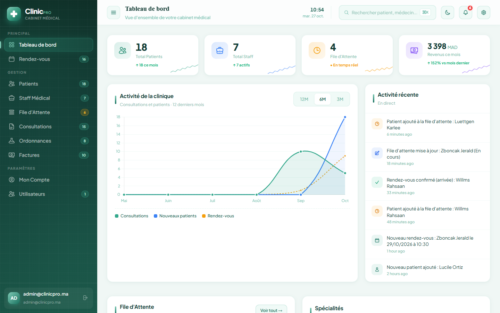
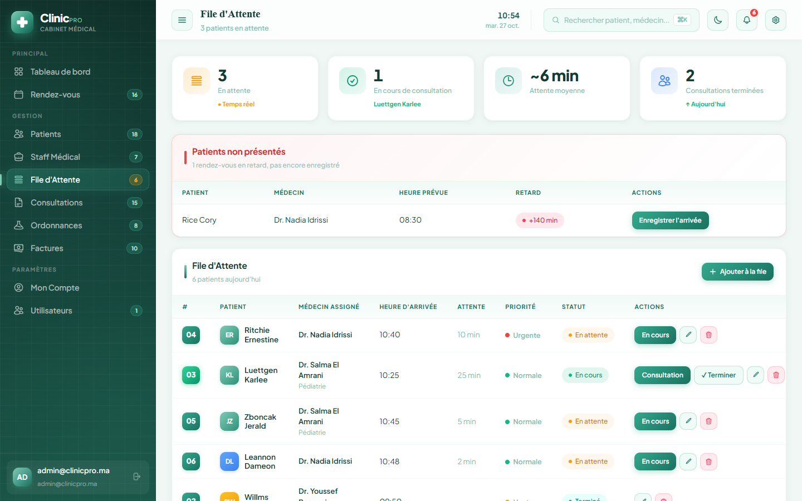
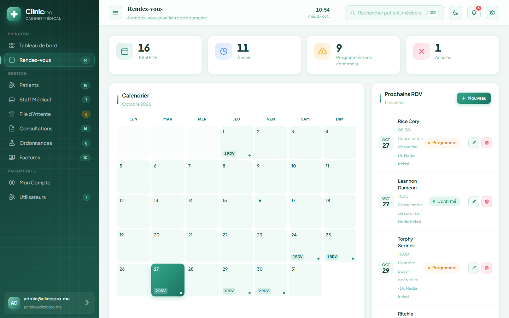
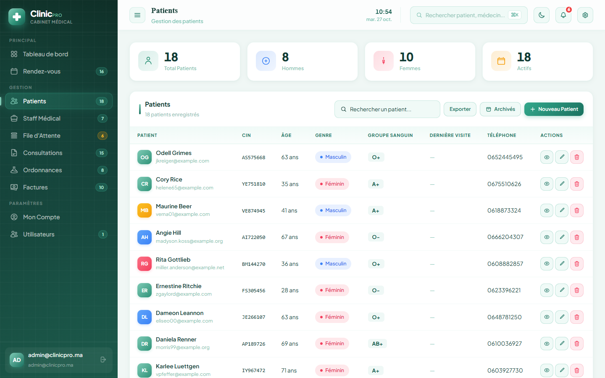
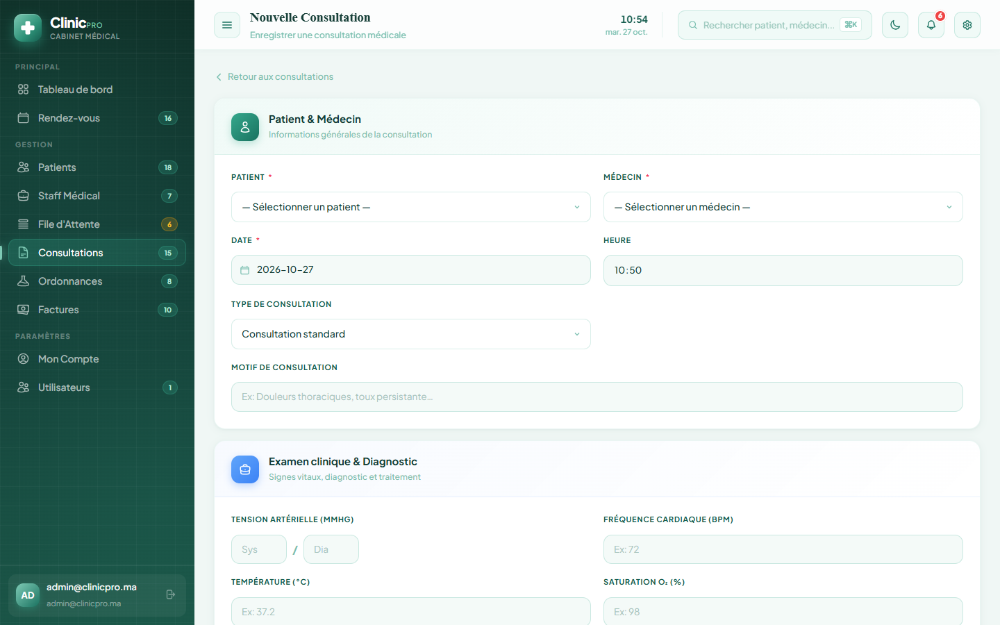
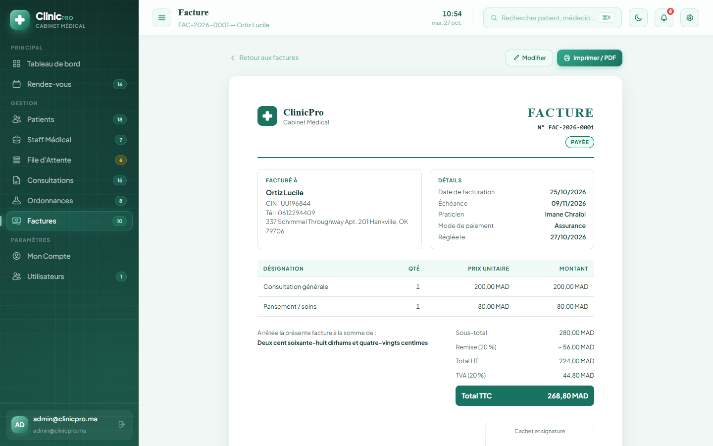
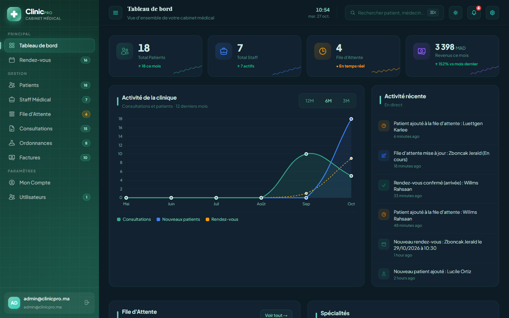
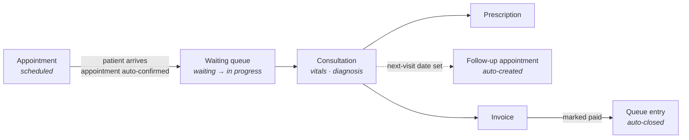
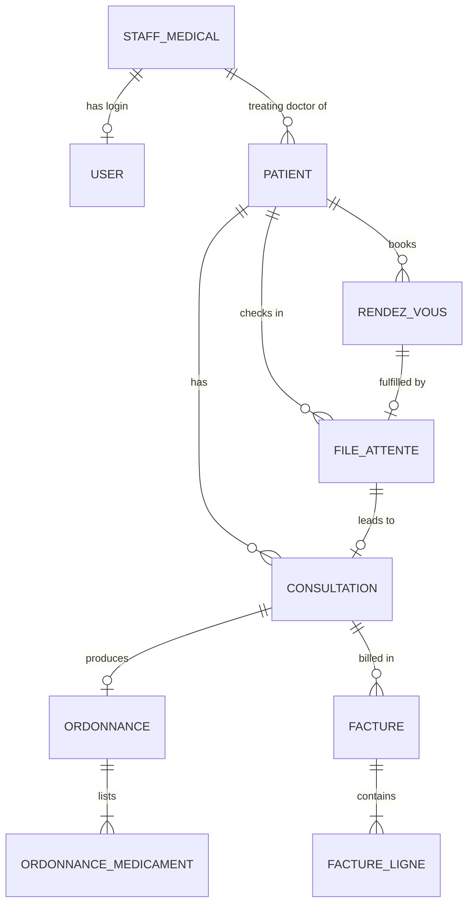

<div align="center">

# ClinicPro

**A full-stack clinic management system: patients, appointments, waiting room, consultations, prescriptions and billing in one app.**

[](https://github.com/AyoubBellaoui/clinique-medicale-app/actions/workflows/tests.yml)




</div>

---

## About

ClinicPro runs the day-to-day work of a small medical practice. The front desk books appointments and checks patients into a live waiting queue. Doctors record consultations and write prescriptions. Administrative staff issue and track invoices. Each staff member sees only the modules their role allows.

I built it as my **final-year project (PFE)**, working from the real workflow of a clinic. The interface is in French for French-speaking clinics in Morocco (amounts are in MAD). The code, comments and documentation are in English.

### Highlights

- **7 integrated modules** covering a patient's whole visit, from booking to payment
- **Role-based access control** with four staff roles, enforced server-side by custom middleware
- **Workflow automation across modules**: checking a patient in confirms their appointment, a consultation can schedule its own follow-up, and paying an invoice closes the visit
- **Safe under concurrent use**: database locks prevent double-booked doctors and duplicate queue tickets or invoice numbers
- **Medical records are archived, not deleted**, so patient history stays intact and can be restored
- **76 automated feature tests** run by GitHub Actions on every push

---

## Screenshots

| Waiting queue | Appointments |
|:---:|:---:|
|  |  |
| **Patients** | **New consultation** |
|  |  |
| **Printable invoice** | **Dark mode** |
|  |  |

---

## Features

| Module | What it does |
|--------|--------------|
| **Dashboard** | Live KPIs (patients, staff, queue size, monthly revenue vs. last month), a 12-month activity chart, consultations by specialty, today's queue, upcoming appointments and a recent-activity feed |
| **Patients** | Full patient record: identity, medical data (blood type, allergies, history), insurance, emergency contact and treating doctor. Search, archive and restore |
| **Appointments** | Monthly calendar and upcoming list. Blocks double-booking a doctor and booking times that have already passed |
| **Waiting queue** | Daily tickets ordered by priority (urgent patients go first), live wait times, one-click status changes, and **no-show detection** for late patients who haven't checked in |
| **Consultations** | Vital signs, diagnosis, treatment and requested exams (lab tests, imaging, physiotherapy). Setting a next-visit date creates the follow-up appointment automatically |
| **Prescriptions** | Any number of medications per prescription, each with dosage and duration. Can be linked to a consultation to pre-fill patient, doctor and diagnosis |
| **Billing** | Invoices with service lines, discount, tax and insurance coverage. Numbered `FAC-2026-0001`, `FAC-2026-0002`… each year. Unpaid invoices past their due date show as overdue. Prints as an A4 invoice (or PDF) with the total written out in words |
| **Staff & users** | Admin-only. Medical staff records (HR and contract data) can be archived and restored. Login accounts: create them, assign roles and reset passwords |
| **Across the app** | Global search (<kbd>Ctrl</kbd>/<kbd>⌘</kbd>+<kbd>K</kbd>), in-app notification bell, toast feedback on every action, light/dark theme |

### A patient visit, end to end



---

## Engineering decisions

Some of the problems that took more thought than plain CRUD:

- **Race conditions.** Uniqueness checks during validation can't stop two requests that arrive at the same moment. So booking an appointment locks the doctor's row inside a transaction and checks the slot again. Queue tickets are numbered under a lock as well. Invoice numbers use a unique index and are regenerated and retried if two invoices collide.
- **Data retention.** Consultations, prescriptions and invoices have legal value, so patients and staff use soft deletes. Relationships load archived records too (`withTrashed()`), so an old invoice still shows the patient's name after the patient is archived.
- **Derived state instead of stored state.** "Overdue" is not saved on the invoice. It is calculated from the due date when the page loads, so there is no background job and the value can't go stale.
- **Totals calculated on the server.** The billing form previews the total in the browser, but the server recalculates it with the same formula. The client's numbers are never trusted.
- **Admin safety.** The app won't let an admin delete their own account, or demote or delete the last remaining admin, because either would lock everyone out of user management.
- **Authentication.** Login attempts are rate-limited per IP and per email (5 per minute), and the session is regenerated on login to prevent session fixation.
- **Portable SQL.** MySQL-only queries such as `ORDER BY FIELD()` were rewritten as portable `CASE WHEN`, so the same code runs on MySQL in production and SQLite in tests.

---

## Tech stack

| Layer | Technologies |
|-------|--------------|
| Backend | PHP 8.3, Laravel 13 (Eloquent ORM, middleware, notifications, rate limiting) |
| Database | MySQL 8 (SQLite in-memory for tests) |
| Frontend | Blade templates, Tailwind CSS v4, vanilla JavaScript, Chart.js, PHPFlasher |
| Tooling | Vite 8, Composer, npm, Laravel Pint |
| Testing & CI | PHPUnit 12 feature tests, GitHub Actions |

---

## Architecture

The app follows Laravel's MVC structure. Each module has a controller in [`app/Http/Controllers`](app/Http/Controllers), Eloquent models in [`app/Models`](app/Models), and Blade views in [`resources/views`](resources/views). All routes are in [`routes/web.php`](routes/web.php). Every write action follows the same steps: **validate → save → notify → flash a message → redirect**.

### Data model



Appointments, queue entries, consultations, prescriptions and invoices also reference the patient and the staff member involved. Table names are in French to match the domain: *rendez-vous* = appointment, *file d'attente* = waiting queue, *ordonnance* = prescription, *facture* = invoice.

### Roles & permissions

There are five roles, grouped into three permission tiers. The custom [`EnsureRole`](app/Http/Middleware/EnsureRole.php) middleware enforces them on the server, and the sidebar hides links a user can't open.

| Module | Allowed roles |
|--------|---------------|
| Dashboard, Patients, Waiting queue, Appointments, My account | All roles |
| Consultations, Prescriptions | `admin`, `medecin` (doctor), `infirmier` (nurse) |
| Billing | `admin`, `secretariat` (front desk), `technicien` (technician) |
| Medical staff, User accounts | `admin` only |

---

## Getting started

### Requirements

- PHP ≥ 8.3 with `pdo_mysql`, `mbstring`, `openssl`, `tokenizer`, `xml`
- Composer
- Node.js ≥ 18 and npm
- MySQL ≥ 8 (on Windows, Laragon or XAMPP works)

### Installation

```bash
git clone https://github.com/AyoubBellaoui/clinique-medicale-app.git
cd clinique-medicale-app
cp .env.example .env
```

`.env.example` uses SQLite by default. To use MySQL instead, create a `medical_app_db` database and replace the `DB_` block in `.env`:

```env
DB_CONNECTION=mysql
DB_HOST=127.0.0.1
DB_PORT=3306
DB_DATABASE=medical_app_db
DB_USERNAME=root
DB_PASSWORD=
```

Then run the one-step setup:

```bash
composer run setup
```

This command installs the PHP and JavaScript dependencies, generates the app key, runs the migrations, seeds **realistic demo data** (staff, patients, appointments, consultations, invoices…) and builds the frontend assets.

### Run

```bash
php artisan serve     # http://127.0.0.1:8000
npm run dev           # optional, in a second terminal: live reload for views and CSS
```

> **Windows note:** use the two commands above, not `composer run dev`. That script also starts `php artisan pail`, which needs the `pcntl` extension. `pcntl` isn't available on Windows, so the whole script stops.

### Demo login

| Email | Password |
|-------|----------|
| `admin@clinicpro.ma` | `admin123` |

There is no public sign-up. Other accounts are created by an admin under **Utilisateurs** (`/users`). **Change this password before any real deployment.**

### Clinic details on invoices

The clinic's name and contact details printed on invoices come from `.env`. Leave a value empty to leave it off the invoice:

```env
CLINIC_NAME="ClinicPro"
CLINIC_TAGLINE="Cabinet Médical"
CLINIC_ADDRESS=
CLINIC_PHONE=
CLINIC_EMAIL=
CLINIC_ICE=
```

---

## Testing

```bash
php artisan test
```

The suite has **76 feature tests** covering every module, access control by role, data retention (archive and restore), double-booking, invoice totals and the account safety rules. The tests run on an in-memory SQLite database, so no setup is needed. GitHub Actions also runs them on every push and pull request to `main`.

---

## Deployment (Linux)

1. Set `APP_ENV=production` and `APP_DEBUG=false` in `.env`.
2. Give the web server write access to the cache and storage folders. Without it, every page returns a 500 error:

   ```bash
   chown -R $USER:www-data storage bootstrap/cache
   chmod -R 775 storage bootstrap/cache
   ```

---

## Project documentation

The repository also includes the design documents produced for the project defense:

- [`UML/`](UML): class diagram and use-case diagram
- [`Rapport/`](Rapport): project report (*Mémoire professionnel*), with ERD, MVC and sequence diagrams
- [`PROGRESS.md`](PROGRESS.md): step-by-step development log

---

## License

Released under the [MIT License](LICENSE).

---

## Author

**Ayoub Bellaoui**

[](https://github.com/AyoubBellaoui)
<!-- Add your LinkedIn and portfolio links here, e.g.:
[](https://www.linkedin.com/in/your-profile)
-->
